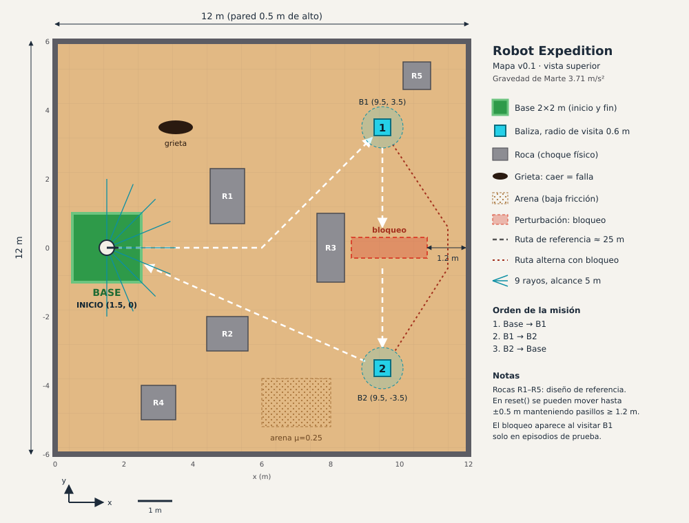

# Ambiente v0.1

> Ficha de diseño de **Robot Expedition**. Las secciones siguen la plantilla
> `plantilla-ambiente-v0.1.md`. El ambiente está implementado en 3D con MuJoCo
> en [`robot_expedition/envs/beacon_expedition.py`](../robot_expedition/envs/beacon_expedition.py).
> Los números de las secciones de métricas y transiciones salen de ejecuciones
> reales (`python -m robot_expedition ...`), no de cálculos a mano.

## Mision y mapa

**Misión:** un rover sale de la base, visita **la baliza 1 y después la
baliza 2** (en ese orden) y **regresa a la base antes de agotar la batería**,
sin caer en la grieta, sin volcar y chocando lo menos posible.



(Vista superior; también en PNG: [mapa-ambiente-v0.1.png](mapa-ambiente-v0.1.png).
La vista 3D está en `expedicion_3d.html`.)

**El mundo es 3D y la física la calcula MuJoCo:**
- Gravedad de Marte: 3.71 m/s².
- Terreno con relieve (heightfield de 121 × 121 puntos, uno cada 0.1 m).
- Rocas y paredes con colisión.
- Un rover con ruedas con motor.

| Elemento | Posición / tamaño | Unidad | Comentario |
|---|---|---|---|
| Sala | x ∈ [0, 12], y ∈ [-6, 6] | m | Paredes de 0.5 m de alto |
| Terreno | 6 dunas gaussianas de 0.12 a 0.30 de alto | m | Plano cerca de la base, las balizas y las rocas. El rover sube, baja y se inclina |
| Base (inicio y fin) | Centro (1.5, 0), cuadrado de 2 × 2 | m | El rover empieza en el centro mirando hacia +x |
| Baliza 1 (B1) | (9.5, 3.5), radio de visita 0.6 | m | Primera meta |
| Baliza 2 (B2) | (9.5, -3.5), radio de visita 0.6 | m | Segunda meta |
| Rocas R1–R5 | Cajas de 0.8–1.2 × 0.8–2.0 × 0.5–1.0 | m | Colisión física. Con `--jitter 0.5` se mueven hasta ±0.5 m |
| Grieta | (3.5, 3.5), 1.0 × 0.4, **0.5 de profundidad** | m | Es un hueco real en el terreno: el rover cae dentro (falla). Los rayos no la ven |
| Arena | x ∈ [6, 8], y ∈ [-5.2, -3.8] | m | Suelo suelto: una fuerza de arrastre frena al rover |

La ruta de referencia base → B1 → B2 → base mide **25.2 m** de centro a centro.

**El rover** (cuerpo libre con 6 grados de libertad):

| Pieza | Medida | Masa |
|---|---|---|
| Chasis | 0.50 × 0.32 × 0.10 m | 8 kg |
| 2 ruedas motrices (izquierda y derecha) | radio 0.1 m, separadas 0.42 m | 1 kg c/u |
| 2 apoyos libres (adelante y atrás) | esferas de 0.05 m sin fricción, 3 cm sobre el suelo | 0.2 kg c/u |
| Mástil con el sensor de rayos | a 0.3 m sobre el chasis | 0.2 kg |

Los apoyos están 3 cm por encima del suelo para que las ruedas siempre carguen
el peso. Cuando estaban al ras, en las curvas del terreno el rover quedaba
apoyado en ellos y las ruedas giraban en el aire.

**Dos ambientes en el repositorio** (los dos en MuJoCo 3D):

| Ambiente | Archivo | Para qué sirve |
|---|---|---|
| **Expedición con rover** (esta ficha) | `envs/beacon_expedition.py` | La misión completa con avance y giro, como pide la ficha del profesor. Q-learning la aprende |
| **Bípedo** | `envs/mars_biped.py` | Aprender a caminar con 10 motores. Q-learning tabular no lo logra (ver Decisiones pendientes) |

**Parametría (se fija antes de ejecutar):**

| Parámetro | Valor v0.1 | Rango a explorar | Unidad | Qué cambia | Dónde |
|---|---|---|---|---|---|
| Tamaño del mapa | 12 × 12 | 8 × 8 – 20 × 20 | m × m | Escala del recorrido y batería necesaria | `MAP_W`, `MAP_H` |
| Altura de las dunas | 0.12 – 0.30 | 0 – 0.5 | m | Inclinación, tracción, riesgo de volcar | `DUNES` |
| Ancho de pasillos | ≥ 0.6 libre para el rover | 0.6 – 2.0 | m | Dificultad de navegación | `--jitter` |
| Velocidad máxima | 0.6 | 0.3 – 1.0 | m/s | Capacidad de avance | `V_MAX` |
| Torque por rueda | 1.5 | 0.5 – 3.0 | N·m | Aceleración y capacidad de subir dunas | `forcerange` |
| Ruido de distancia | σ = 0.02 | 0 – 0.10 | m (desv. estándar) | Calidad de los sensores | `--ray-noise` |
| Radio de visita | 0.6 | 0.4 – 1.0 | m | Precisión exigida en las balizas | `VISIT_RADIUS` |
| Paso de física | 0.02 | 0.005 – 0.02 | s | Precisión contra velocidad de la simulación | `TIMESTEP` |
| Límite de tiempo | 400 | 200 – 800 | pasos (0.5 s c/u) | Margen para equivocarse | `--max-steps` |

## Variables y unidades

**Estado del mundo** (lo que existe en MuJoCo):

| Variable | Significado | Unidad | Rango | ¿La ve el agente? |
|---|---|---|---|---|
| `x, y, z` | Posición del chasis | m | x [0, 12], y [-6, 6], z [-0.5, 0.35] | **No** (solo la distancia y dirección al objetivo) |
| `q` | Orientación en 3D (cuaternión) | — | norma 1 | Solo el cabeceo y el alabeo |
| `cabeceo, alabeo` | Inclinación adelante/atrás y lateral | rad | aprox. [-0.5, 0.5] | **Sí** |
| `v` | Velocidad hacia adelante | m/s | aprox. [-0.3, 0.8] | Sí (normalizada) |
| `ω` | Velocidad de giro | rad/s | aprox. [-1.5, 1.5] | Sí (normalizada) |
| `ω_izq, ω_der` | Giro de cada rueda | rad/s | [-8, 8] | No |
| `B` | Batería | % | [0, 100] | Sí (normalizada a [0, 1]) |
| `etapa` | Objetivo actual: 1 = B1, 2 = B2, 3 = base | — | {1, 2, 3} | Sí (one-hot) |
| `visitadas` | Balizas visitadas (v1, v2) | — | {0, 1}² | Indirectamente (por la etapa) |
| `choques` | Pasos con contacto entre el rover y una roca o pared | pasos | [0, 400] | No (solo en `info`) |
| `t` | Paso del episodio | pasos | [0, 400] | No |
| Terreno, rocas, balizas, base y grieta | El mundo | m | ver mapa | **No** (solo a través de los rayos, la inclinación y la dirección al objetivo) |

## Observaciones y acciones

**Observación** (vector `float32` de 20 valores):

| Índice | Bloque | Unidad | Rango |
|---|---|---|---|
| 0–8 | **9 rayos de distancia** de -90° (derecha) a +90° (izquierda), cada 22.5°, con ruido N(0, 0.02) | m | [0, 5] (5 = no hay nada) |
| 9 | Distancia al objetivo actual | m | [0, 17] |
| 10–11 | Dirección al objetivo: sen y cos del ángulo relativo | — | [-1, 1] |
| 12 | Velocidad hacia adelante / 0.6 | — | [-1, 1] |
| 13 | Velocidad de giro / 1.2 | — | [-1, 1] |
| 14 | Batería / 100 | — | [0, 1] |
| 15–17 | Etapa (one-hot B1, B2, base) | — | {0, 1} |
| 18–19 | Cabeceo y alabeo del chasis | rad | [-π, π] |

Los rayos se lanzan en 3D con `mujoco.mj_ray`:
- Salen horizontales desde el sensor del mástil y solo detectan paredes, rocas
  y el bloqueo; el terreno no cuenta como obstáculo.
- **No detectan la grieta**, porque es un hueco. El agente aprende a evitarla
  por experiencia.

**Acción** (`Discrete(5)`): cada acción pide una velocidad y un giro. El
ambiente los convierte en velocidad para cada rueda (tracción diferencial),
`ω_rueda = (v ∓ ω · 0.21) / 0.1`, y los motores de velocidad de MuJoCo la
siguen. El torque está limitado a 1.5 N·m por rueda, y eso limita la
aceleración y la capacidad de subir pendientes.

| # | Acción | Velocidad pedida (m/s) | Giro pedido (rad/s) |
|---|---|---|---|
| 0 | avanzar | 0.6 | 0 |
| 1 | avanzar + izq | 0.4 | +0.8 |
| 2 | avanzar + der | 0.4 | -0.8 |
| 3 | girar izq | 0 | +1.2 |
| 4 | girar der | 0 | -1.2 |

**Estado discreto del agente Q-learning** (`robot_expedition/qlearning.py`): se
arma **solo con la observación**, sin `x, y`.

| Componente | Cómo se discretiza | Valores |
|---|---|---|
| Etapa | B1, B2, base | 3 |
| Distancia al objetivo | cortes en 1.0, 2.5 y 5.0 m | 4 |
| Ángulo al objetivo | sectores de 45° | 8 |
| Obstáculo a la derecha (rayos 0–2) | cortes en 0.5 y 1.0 m | 3 |
| Obstáculo al frente (rayos 3–5) | cortes en 0.6 y 1.2 m | 3 |
| Obstáculo a la izquierda (rayos 6–8) | cortes en 0.5 y 1.0 m | 3 |

Son 2 592 estados × 5 acciones = 12 960 valores Q, y el agente visita unos
1 180 estados. La inclinación (índices 18–19) todavía no entra en el estado
discreto (ver Decisiones pendientes).

## Dinamica

Cada paso del agente dura **0.5 s** (2 decisiones por segundo). En cada
`step(a)` ocurre lo siguiente:

1. **Acción:** se fija la velocidad objetivo de cada rueda.
2. **Física (MuJoCo):**
   - Se integran 25 pasos de 0.02 s, en 5 bloques de 0.1 s.
   - MuJoCo calcula la gravedad, el torque de los motores, el contacto de las
     ruedas con el terreno 3D (fricción 1.2) y los choques.
   - En la arena se aplica una fuerza de arrastre horizontal de
     `−12 · v` N.
   - Al subir una duna el rover se inclina y pierde velocidad. Al pisar la
     grieta cae dentro.
3. **Choques:** después de cada bloque se revisa si hay algún contacto entre el
   rover y una roca, pared o el bloqueo (`choque = 1`).
4. **Batería:** `B ← max(0, B − (0.1 + 0.4·E))`, con
   `E = min(1, (v/0.6)² + 0.25·(ω/1.2)²)` medidos sobre la velocidad real.
   - Avanzando a fondo gasta 0.5 %/paso, girando en el sitio 0.2 %/paso y
     quieto 0.1 %/paso.
   - La misión del agente entrenado (unos 120 pasos) gasta cerca del 45 %.
5. **Progreso:** `d_{t-1} − d_t` hacia el objetivo que estaba activo **al
   inicio** del paso.
6. **Visitas:**
   - Si `etapa = 1` y el rover está a menos de 0.6 m de B1: `v1 = 1` y la etapa
     pasa a 2.
   - Igual para B2 (la etapa pasa a 3).
   - Entrar al radio de una baliza que **no** es el objetivo actual no hace nada.
   - Con perturbación, al visitar B1 la roca del bloqueo aparece en MuJoCo.
7. **Fin:** se revisan éxito, grieta, vuelco, batería y tiempo.
8. **Observación nueva:** los 9 rayos, la dirección al nuevo objetivo y la
   inclinación.

**Aleatoriedad en `reset(seed)`:**
- El ruido de los rayos cambia en cada paso.
- Con `--jitter`, las rocas se mueven y una búsqueda en anchura (BFS) comprueba
  que siga habiendo una ruta base → B1 → B2.
- El terreno, las balizas y la base son fijos en v0.1.

## Recompensa

Recompensa en cada paso:

```
r_t = 1.0 · (d_{t-1} − d_t)      # progreso hacia el objetivo actual (m)
    − 0.01                        # costo de tiempo
    − 0.02 · E_t                  # consumo
    − 0.5 · choque_t              # choque con roca, pared o bloqueo
    + 10   si visita B1 en la etapa 1          (solo una vez)
    + 10   si visita B2 en la etapa 2          (solo una vez)
    + 50 + 20 · (B / 100)  si llega a la base en la etapa 3 (éxito)
    − 50   si cae en la grieta, vuelca o agota la batería
```

Por qué se eligió así:
- **El progreso es la diferencia de distancias**, que funciona como un
  potencial. Si el rover va y vuelve, la suma de esos términos se cancela, así
  que oscilar no da puntos.
- **Los bonos solo valen para la baliza del objetivo actual y se dan una vez.**
  Esto responde a la pregunta del reto de la ficha: no se gana visitando la
  misma baliza repetidas veces.
- **Fallar (−50) cuesta más que agotar el tiempo** (400 × 0.01 = 4, más como
  máximo 8 de consumo). Así no le conviene terminar el episodio a propósito.
- **El bono final depende de la batería que quede**, lo que premia rutas
  eficientes.

## Exito, fracaso y limite de tiempo

| Caso | Condición | Gymnasium | `info["end"]` |
|---|---|---|---|
| **Éxito** | `v1 = 1`, `v2 = 1`, el rover dentro del cuadrado de la base y `B > 0` | `terminated = True`, `info["success"] = True` | `exito` |
| **Fracaso: grieta** | El chasis sobre la grieta o por debajo de z = −0.15 m | `terminated = True` | `grieta` |
| **Fracaso: vuelco** | El eje vertical del chasis inclinado más de unos 73° (`upright < 0.3`) | `terminated = True` | `volco` |
| **Fracaso: batería** | `B = 0` | `terminated = True` | `bateria` |
| **Límite de tiempo** | `t = 400` pasos (200 s simulados) | `truncated = True` | `tiempo` |

El límite de 400 pasos es más de 3 veces la misión del agente entrenado (unos
120 pasos). Como `truncated` es distinto de `terminated`, el agente sigue
estimando el valor futuro cuando se acaba el tiempo.

## Metricas e incidente

Se evalúa con **50 episodios con semillas que no se usan en el
entrenamiento**, con la política greedy (ε = 0). Comando:
`python -m robot_expedition evaluate [--perturbation] [--jitter 0.5]`.

| # | Métrica | Cómo se calcula | Unidad |
|---|---|---|---|
| 1 | **Tasa de éxito** | Episodios exitosos / 50 | % |
| 2 | **Eficiencia de ruta** | 25.2 m / distancia recorrida (solo en éxitos) | 1 = igual a la ruta de referencia |
| 3 | **Choques por episodio** | Media de `info["collisions"]` | pasos con choque |

También se registran: las balizas visitadas (0–2), la batería final, los pasos
y la causa del fin.

**Resultados medidos** (Q-learning, 2000 episodios de entrenamiento, semilla 7,
unos 4 minutos en CPU):

| Escenario | Éxito | Eficiencia | Choques / ep. | Batería final | Pasos | Causa del fin |
|---|---|---|---|---|---|---|
| Normal | **100 %** | 0.96 (26.2 m) | 0.0 | 55.2 % | 119.7 | 50 éxitos |
| Rocas movidas ±0.5 m (`--jitter 0.5`) | **96 %** | 0.96 (26.3 m) | 0.14 | 53.5 % | 140.7 | 48 éxitos, 2 por tiempo |
| **Corredor bloqueado** (`--perturbation`) | **34 %** | 0.82 (30.7 m) | 191.2 | 38.0 % | 335.7 | 17 éxitos, 33 por tiempo |

Así evoluciona el entrenamiento:

| Episodios | ε (exploración) | Éxito | Otras causas de fin |
|---|---|---|---|
| 1–250 | alto | 6 % | tiempo, grieta y batería |
| 251–500 | — | 73 % | — |
| 501–750 | — | 95 % | aparece el **vuelco** como causa nueva |
| 1001–1250 | — | 100 % | — |
| 1751–2000 | 0.05 | 98 % | — |

**Perturbación: corredor bloqueado.**
- **Qué pasa:** al visitar B1 aparece en MuJoCo una roca de 2.2 × 0.6 × 0.8 m
  centrada en (9.7, 0), que corta el camino directo B1 → B2. Queda un pasillo
  junto a la pared este y el rodeo por el oeste de R3.
- **Cuándo:** solo en la evaluación. El agente nunca la vio al entrenar.
- **Resultado:** la tasa de éxito baja **66 puntos porcentuales**, mucho más que
  el umbral de 20 que nos fijamos, así que **el agente v0.1 no es robusto** a
  este incidente.
  - Con la física 3D el rover se queda empujando contra la roca: 191 pasos con
    choque por episodio.
  - En una versión 2D anterior sin física, el éxito con bloqueo era del 62 %:
    los contactos reales hacen más difícil despegarse del obstáculo.
  - Mejoras posibles: entrenar con el bloqueo en una fracción de los episodios,
    y que el estado distinga mejor "obstáculo justo enfrente".
- **Variante:** subir el ruido de los rayos con `--ray-noise 0.05`.

## Cinco transiciones

Son transiciones reales del agente entrenado. Salen de
`python -m robot_expedition transitions --perturbation --seed 5`: un episodio de
evaluación con el bloqueo activo en el que el rover encontró el pasillo este.
La dirección es el ángulo al objetivo relativo al frente del rover (+ = a la
izquierda). El cabeceo es negativo cuando la nariz apunta hacia arriba.

| t | Observación (resumen) | Acción | Nuevo estado | Recompensa | ¿Fin? |
|---|---|---|---|---|---|
| 0 | etapa B1; objetivo a 8.73 m y +23°; rayo frontal 5.00 m; batería 100.0 % | avanzar + izq | (1.66, 0.03, z +0.00); cabeceo -8°; etapa B1; batería 99.7 % | +0.142 | No |
| 51 | etapa B1; objetivo a 0.77 m y -12°; rayo frontal 3.40 m; batería 82.6 % | avanzar | (9.02, 3.50, z -0.00); cabeceo -7°; etapa B2; batería 82.1 %; **visita B1** | +10.258 | No |
| 110 | etapa B2; objetivo a 0.67 m y -14°; rayo frontal 3.54 m; batería 63.4 % | avanzar | (9.84, -3.32, z -0.00); cabeceo -5°; etapa base; batería 62.9 %; **visita B2** | +10.252 | No |
| 131 | etapa base; objetivo a 5.76 m y +22°; rayo frontal 5.00 m; batería 55.9 % | avanzar + der | (6.88, -1.54, **z +0.15**); **cabeceo +16°** (bajando la duna sur); etapa base; batería 55.5 % | +0.146 | No |
| 153 | etapa base; objetivo a 1.41 m y -2°; rayo frontal 3.12 m; batería 47.6 % | avanzar | (2.36, -0.72, z -0.00); cabeceo -3°; etapa base; batería 47.1 % | +59.691 | **Sí** (éxito) |

Lectura:
- **t = 0:** el rover arranca. El cabeceo de −8° es la inclinación hacia atrás
  al acelerar, que la física produce sola.
- **t = 51:** el bono de +10 por llegar a B1.
- **t = 131:** el rover baja la duna, 15 cm más alto que el suelo y con la nariz
  16° hacia abajo. El progreso sigue sumando.
- **t = 153:** el bono final es 50 + 20 · 0.471 = 59.4, más el progreso del
  último paso.

Para ver un choque, el mismo comando con `--seed 7` muestra el paso 68:
`avanzar + izq` contra el bloqueo, recompensa −0.474.

## Posibles trampas y decisiones pendientes

**Formas de ganar puntos sin cumplir la misión, y cómo las evitamos.** Cada una
tiene una prueba automática en `tests/test_beacon_expedition.py`.

| Trampa | Por qué daría puntos | Cómo se evita | Prueba |
|---|---|---|---|
| Visitar la misma baliza muchas veces | Si el bono se diera en cada entrada al radio | Cada bono se da una sola vez y solo si la baliza es el objetivo actual | `test_b1_bonus_once_and_in_order` |
| Visitar B2 antes que B1 | Si las balizas no tuvieran orden | Solo cuenta la baliza de la etapa actual | `test_b1_bonus_once_and_in_order` |
| Ir y venir cerca de la baliza | Ganaría progreso cada vez que se acerca | El progreso es la diferencia de distancias (ir y volver suma cero) y se paga el tiempo | — |
| Girar o quedarse quieto | Si hubiera un bono por "estar vivo" (como el +0.02·upright del bípedo) | No hay bono por sobrevivir: cada paso cuesta −0.01 y consumo | `test_spinning_in_place_does_not_pay` |
| Volver a la base sin visitar las balizas | Si el bono de la base no dependiera de la etapa | El bono de la base solo cuenta en la etapa 3 | `test_base_without_beacons_is_not_success` |
| Terminar a propósito (grieta o vuelco) | Si fallar costara menos que el tiempo restante | Fallar cuesta −50, más que todo el costo de tiempo y consumo (−12 como máximo) | `test_crack_ends_episode` |
| Atravesar rocas o empujarse contra ellas | Si la física dejara pasar | MuJoCo detiene al rover en el contacto, y cada paso con choque cuesta −0.5 | `test_collision_is_penalized` |

Otras pruebas de la física 3D: `test_dune_lifts_and_tilts_rover` (el rover
sube y se inclina en una duna) y `test_rays_see_rock_in_3d` (los rayos de
`mj_ray` detectan una roca a la distancia correcta).

**Decisiones pendientes (para discutir en el equipo):**
1. **El bípedo.** Con el Q-learning tabular de `qlearning_agent.py`, el bípedo
   de MuJoCo no aprende a caminar.
   - Medición del 28 oct: 300 episodios, 0 éxitos, como máximo 79 pasos antes
     de caer y 9 % de progreso.
   - Propuesta: la misión con el rover usa Q-learning, y el bípedo queda para
     PPO (`train.py`) más adelante.
2. ¿Entrenar con el bloqueo en una fracción de los episodios (por ejemplo 30 %)
   para mejorar la robustez?
3. ¿Agregar la inclinación al estado discreto? Así el agente podría aprender a
   rodear las dunas empinadas y a evitar volcar.
4. ¿Balizas o dunas aleatorias? Hoy son fijas. Como el estado no usa `x, y`, la
   política debería transferirse en parte, pero no está medido.
5. ¿Agregar un sensor de suelo para que el agente "vea" la grieta?
6. Calibrar los coeficientes de batería y recompensa con más semillas, y
   reportar la media y la desviación de varias ejecuciones de entrenamiento.
