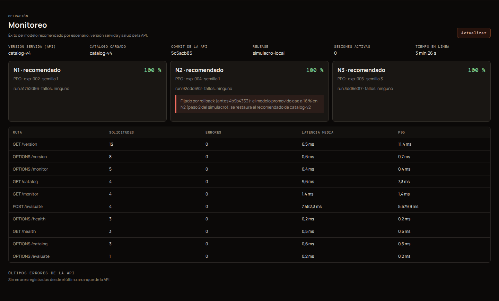

# Prueba de rollback y reconstrucción

> **Paso 11 del plan.**
> - **Log completo:** [rollback-log.txt](rollback-log.txt).
> - **Evidencia del flow de Prefect:**
>   [pipeline/20261103T022040Z-rollback-n2.json](pipeline/20261103T022040Z-rollback-n2.json).
> - **Historial del catálogo:** [`catalog/history.jsonl`](../../catalog/history.jsonl).

## 1. Qué significa rollback aquí

**Rollback** es volver a servir, en un nivel, un `run_id` que **ya fue el
recomendado** en una versión anterior del catálogo, y comprobar contra la API
que se sirve y que funciona.

`pipelines/catalog.py rollback` **rechaza** un run que nunca fue servido.
Promover un candidato nuevo es otra operación (`promote`), con su propio
registro. Registrar un candidato o actualizar la web no lo promueve.

Cada rollback:
1. publica una versión nueva del catálogo (nunca sobrescribe la anterior);
2. fija el nivel con un *pin* para que la selección automática no lo deshaga;
3. deja una línea en `catalog/history.jsonl` con quién, cuándo, de qué run a
   cuál y por qué;
4. el flow `robot-expedition-rollback` (Prefect) reevalúa el run restaurado y
   comprueba `/version` y `/catalog` de la API.

## 2. Simulacro del 2026-11-03

Se hizo contra la API local (`uvicorn api.main:app`, commit `5c5acb857f`) y la
web en `localhost:5173`. Script: [`scripts/simulacro_rollback.sh`](../../scripts/simulacro_rollback.sh).

| Paso | Hora (UTC) | Qué pasó | Versión servida | N2 servido | Éxito N2 (suite-n2-v1, 50 ep.) |
|---|---|---|---|---|---|
| 0 | 02:20:15 | Estado inicial | `catalog-v2` | `92cdc692` (exp-004 s1) | **100 %** |
| 1 | 02:20:19 | **Promoción manual errónea** (simulacro): `catalog.py promote --level n2 --to 4b9b4353…` | `catalog-v3` | `4b9b4353` (exp-005 s1, entrenado en N3) | — |
| 2 | 02:20:19 | **Detección:** `/evaluate` del recomendado servido | `catalog-v3` | `4b9b4353` | **16 %** (batería 28, grieta 10, tiempo 4) |
| 3 | 02:20:40 | **Rollback con Prefect:** `flow.py --rollback n2 --to 92cdc692… --api-url http://127.0.0.1:8000` | `catalog-v4` | `92cdc692` | — |
| 4 | 02:20:42 | **Comprobación:** `/version` sirve `catalog-v4` con `n2 = 92cdc692…` y `/evaluate` da el mismo SHA-256 de modelo (`0d34e588ae74…`) | `catalog-v4` | `92cdc692` | **100 %** |
| 5 | 02:21:17 | Fin del simulacro: se quita el pin (`unpin`) y N2 vuelve a la selección automática; el recomendado no cambia | `catalog-v5` → `v6` | `92cdc692` | — |

La etapa 8 del flow (`8-version-servida`) devolvió:

```json
{"checked": true, "served_version": "catalog-v4", "local_version": "catalog-v4",
 "served_recommended": {"n2": "92cdc692fdca465b917fa7c5e8a9902d", "...": "..."}, "in_sync": true}
```

Durante el simulacro, la sección **Monitoreo** de la web mostró:
- la versión servida;
- el pin del rollback con su motivo;
- la latencia y los errores de cada ruta.



### Cómo repetirlo

```bash
python pipelines/catalog.py history                       # versiones y quién las publicó
python pipelines/catalog.py promote --level n2 --to <run_malo> --reason "..."
python pipelines/flow.py --rollback n2 --to <run_anterior> --api-url https://<api> --reason "..."
python pipelines/catalog.py unpin --level n2 --reason "..."
```

En producción, después del rollback hay que subir `catalog/` a `main` y
volver a desplegar la API (`scripts/build_space.py`), porque la API sirve el
catálogo de su imagen. Luego se corre `flow.py --runs <run> --api-url <url>`:
la etapa 8 confirma que la versión desplegada es la del catálogo
(`in_sync: true`).

## 3. Reconstrucción desde un clon limpio

Se hizo el 2026-11-03 siguiendo solo el README:

1. `git clone --branch entrega <repo>` en una carpeta vacía.
2. Se extrajo `robot-expedition-models-v2.zip` (el mismo que se publica en la
   release) con `python -m zipfile -e`.
   - Resultado: `sha256sum -c SHA256SUMS.txt` → **OK**.
3. Se reevaluaron dos modelos históricos con `pipelines/evaluate.py`.

| Modelo | Nivel | Éxito | Casos idénticos a `catalog/results` | SHA de suite, ambiente y modelo |
|---|---|---|---|---|
| exp-001 s1, Q-learning (`4d91d98f`) | N2 | 92 % (batería 4) | **sí, los 50** | iguales |
| exp-002 s1, PPO (`a1752d56`) | N3 | 0 % (tiempo 50) | **sí, los 50** | iguales |

Pasos que faltaban en el README y se agregaron: cómo descargar el ZIP de
modelos sin credenciales y el comando exacto para reevaluar un run del
catálogo.
