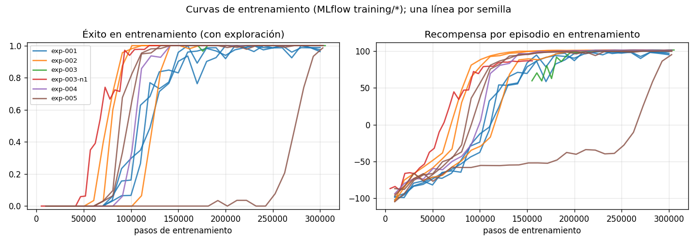
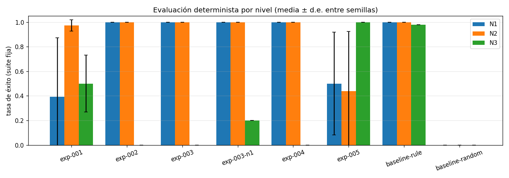

# Experimentos · Robot Expedition

> **Paso 6 del plan:** diseño experimental, que vale el 25 % de la nota.
>
> - **Catálogo de referencia:** `catalog/catalog.json` (`catalog-v6`).
> - **Resultados por caso:** `catalog/results/<run_id>/<nivel>.json`.
> - **Tablas completas:** [resultados/experimentos-tablas.md](resultados/experimentos-tablas.md).
>   Las genera `python scripts/report_experiments.py`; ningún número de este
>   documento se copió a mano de una terminal.

## 1. Protocolo

Estas reglas valen para todos los experimentos:

- **Ambiente:** `robot-expedition-3d/1.0.0`, el mismo código para los tres
  niveles ([ficha v1](ambiente-v1.md)).
- **Presupuesto comparable:** 300 000 pasos de entrenamiento por run. PPO
  redondea al múltiplo de su rollout (4 entornos × 2048 = 8192) y termina en
  303 104 pasos. El currículo exp-003 reparte 150 000 + 150 000.
- **Un solo cambio frente a la referencia.** Está declarado en el campo
  `change` de cada YAML.
- **Evaluación determinista** del modelo congelado con las suites fijas de
  50 episodios de cada nivel (`suite-n1-v1`, `suite-n2-v1` y `suite-n3-v1`).
  Las semillas de evaluación (100 000+, 200 000+ y 300 000+) nunca se usan
  para entrenar.
- **Las curvas de entrenamiento** (`training/*` en MLflow, con exploración) se
  reportan **aparte** de la evaluación (`evaluation/*` y la suite fija).
- **Referencias:** baseline aleatorio, baseline de regla y un baseline
  aprendido (exp-001).
- **Finalistas del contraste principal** (exp-001 contra exp-002): tres
  semillas independientes (1, 2 y 3), y **una sola** pasada por el test
  reservado (`test-final`, semillas fuera de Git).
- **Criterios de selección** fijados antes de ver los resultados:
  [`configs/selection.yaml`](../configs/selection.yaml).
- **Equipo:** CPU de un portátil (12 hilos). Cada run usa 1 hilo y los runs
  van en paralelo. En total fueron **125 minutos de CPU** en 12 runs.

## 2. Experimentos

| Exp. | Hipótesis | Cambio frente a la referencia | Nivel | Semillas | Run IDs |
|---|---|---|---|---|---|
| [exp-001](../configs/experiments/exp-001.yaml) | Q-learning tabular aprende la misión en N2 y fija el baseline aprendido | Q-learning con la observación discretizada (2 592 estados) frente al baseline de regla | N2 | 1, 2, 3 | `4d91d98f`, `4ecd569e`, `b724b2e7` |
| [exp-002](../configs/experiments/exp-002.yaml) | PPO con la observación continua normalizada supera en éxito a Q-learning en N2 con el mismo presupuesto | Algoritmo: PPO (MLP) en lugar de Q-learning | N2 | 1, 2, 3 | `a1752d56`, `90be8649`, `5d5c5839` |
| [exp-003-n1](../configs/experiments/exp-003-n1.yaml) → [exp-003](../configs/experiments/exp-003.yaml) | Un currículo N1 → N2 alcanza en N2 al menos el éxito de exp-002 con el mismo presupuesto total | Currículo: 150k pasos en N1 y luego 150k en N2, continuando el checkpoint (`parent_run_id`) | N1 → N2 | 1 | `37314d94` → `6376e42d` |
| [exp-004](../configs/experiments/exp-004.yaml) | Más exploración (`ent_coef` 0.01) evita políticas que giran en el sitio y sube el éxito en N2 | `ent_coef` 0 → 0.01 | N2 | 1 | `92cdc692` |
| [exp-005](../configs/experiments/exp-005.yaml) | **Intervención del incidente:** entrenar en N3 recupera el éxito en N3 sin perder más de 5 puntos en N2 | Nivel de entrenamiento N2 → N3 | N3 | 1, 2, 3 | `4b9b4353`, `f3b2dc4c`, `3dd6e0f7` |

Todos los runs terminaron `completed`. Los 16 runs de humo de la integración
(8 pasos cada uno; 13 `completed` y 3 `failed`) se conservan como evidencia en
[`manifests/smoke/`](../manifests/smoke) y no se publican en el catálogo.

## 3. Resultados

Éxito por experimento y nivel en la suite fija de 50 episodios. Cuando hay
tres semillas, se da la media ± la desviación estándar entre ellas.

| Experimento | N1 | **N2** | N3 | Pasos medios en N2 | Batería final en N2 (éxitos) | Latencia (ms) |
|---|---|---|---|---|---|---|
| baseline aleatorio | 0 % | 0 % | 0 % | 336 | — | 0.01 |
| baseline de regla | 100 % | 100 % | 98 % | 98.8 | 59.6 % | 0.02 |
| exp-001 Q-learning (3 semillas) | 39 ± 48 % | **97 ± 5 %** | 50 ± 23 % | 117–195 | 32–55 % | 0.03–0.05 |
| exp-002 PPO (3 semillas) | 100 ± 0 % | **100 ± 0 %** | 0 ± 0 % | 83–86 | 61.5–62.1 % | 0.25–0.36 |
| exp-003 currículo | 100 % | 100 % | 0 % | 88.0 | 61.4 % | 0.39 |
| exp-004 `ent_coef` 0.01 | 100 % | 100 % | 0 % | 84.6 | 62.2 % | 0.36 |
| exp-005 entrenado en N3 (3 semillas) | 50 ± 42 % | 44 ± 48 % | **100 ± 0 %** | 110–367 | 5–57 % | 0.24–0.38 |

**Test reservado** (N2, 50 semillas que no están en el repositorio; una sola
pasada por run): [`resultados/test-final/`](resultados/test-final).

| Finalista | Semilla 1 | Semilla 2 | Semilla 3 |
|---|---|---|---|
| exp-001 Q-learning | 98 % (1 batería) | 100 % | 100 % |
| exp-002 PPO | 100 % | 100 % | 100 % |

El test reservado coincide con la suite. No hay señales de que la selección se
haya sobreajustado a las semillas de evaluación.

## 4. Análisis y decisiones

### Contraste principal: exp-002 (PPO) contra exp-001 (Q-learning) en N2

- **Éxito:** PPO 100 ± 0 % y Q-learning 97 ± 5 %. La diferencia es de una
  desviación estándar. **No basta para afirmar que PPO "supera en éxito"**:
  dos de las tres semillas de Q-learning también llegan al 100 %.
- **Eficiencia:** aquí sí hay una diferencia clara y consistente entre
  semillas.
  - PPO completa la misión en 83–86 pasos y Q-learning en 117–195.
  - PPO llega con 62 % de batería y Q-learning con 32–55 %.
  - La semilla 1 de Q-learning choca 9.4 veces por episodio y agota la
    batería 4 veces.
- **Costo:** Q-learning entrena más rápido (8.8 ± 0.5 min frente a
  13.0 ± 0.7 min) y decide unas 8 veces más rápido (0.03 ms frente a 0.25 ms).
  Las dos latencias están muy por debajo del paso de 500 ms.
- **Decisión:**
  - **Se selecciona PPO** para servir N2: es igual de exitoso, más eficiente
    y más estable entre semillas.
  - La hipótesis de exp-002 se **acepta solo en parte**: PPO no supera a
    Q-learning en éxito, pero sí en eficiencia.
  - **Q-learning queda como baseline aprendido** registrado.

### exp-003: currículo N1 → N2

- Con 150k pasos en N2, partiendo del checkpoint de N1, llega al 100 % en N2
  sin choques. exp-002 necesita los 300k pasos en N2 para eso.
- La curva de entrenamiento muestra éxito alto desde el primer rollout en N2:
  lo aprendido en N1 se transfiere.
- **Decisión:** se acepta la hipótesis, que pedía al menos el mismo éxito.
  Hay una sola semilla, así que es evidencia exploratoria.
- Dato llamativo: el modelo padre (exp-003-n1, solo N1) ya logra 100 % en N2,
  pero con **125 choques por episodio**: avanza raspando las rocas. El paso
  por N2 elimina esos choques.

### exp-004: más exploración

- Tiene el mismo éxito (100 %) y la misma eficiencia que exp-002, y aprende
  algo más tarde según la curva.
- **Decisión:** la hipótesis **no se confirma**. Con PPO en N2 no apareció la
  política de girar en el sitio que motivaba el cambio (techo de 100 %).
  Se conserva como evidencia.
- **Detalle de selección:** exp-004 es el recomendado de N2 porque se publicó
  primero (`catalog-v1`) y ningún candidato posterior lo supera por
  +5 puntos. Ese criterio está hecho para que el recomendado no cambie por
  ruido. Este run también es el de la prueba de rollback.

### exp-005: intervención para el incidente

Ver [incidente.md](incidente.md).
- En N3 recupera el 100 % en las tres semillas.
- En N2 cae a **44 ± 48 %**: una semilla 100 % y dos 16 %, que agotan la
  batería o se quedan sin tiempo.
- **Decisión:**
  - La hipótesis "sin perder más de 5 puntos en N2" se **rechaza**.
  - exp-005 se recomienda **solo para N3**. N1 y N2 siguen con modelos
    entrenados en N2.

### Hallazgos que no estaban en las hipótesis

- **La grieta de N1 tumba a los modelos de N2 que no son PPO.**
  - Q-learning entrenado en N2 cae al 39 % en N1: 33 caídas en la grieta en la
    semilla 1. N1 no tiene dunas, así que el terreno cambia, y la ruta corta
    hacia B1 pasa junto a la grieta, que los rayos no ven.
  - PPO llega al 100 % en N1 sin haberlo visto nunca.
- **En N3, Q-learning resiste mejor que PPO** (50 ± 23 % frente a 0 %). Su
  estado discreto agrupa los rayos en 3 sectores y no depende tanto del rayo
  frontal muerto. Aun así, el incidente demuestra que la causa principal del
  0 % de PPO es el bloqueo, no el sensor.

## 5. Recomendados (catálogo `catalog-v6`)

| Nivel | Recomendado | Por qué |
|---|---|---|
| N1 | exp-002 semilla 1 (`a1752d56`) | 100 %. Primer recomendado; los demás no lo superan por +5 puntos |
| N2 | exp-004 semilla 1 (`92cdc692`) | 100 %, 0 choques. Ningún candidato lo supera por +5 puntos |
| N3 | exp-005 semilla 3 (`3dd6e0f7`) | 100 %, 0 choques. Intervención del incidente |

Las decisiones de cada candidato, con su motivo, están en
`catalog.json → decisions` y en la web, en el detalle de cada run.
